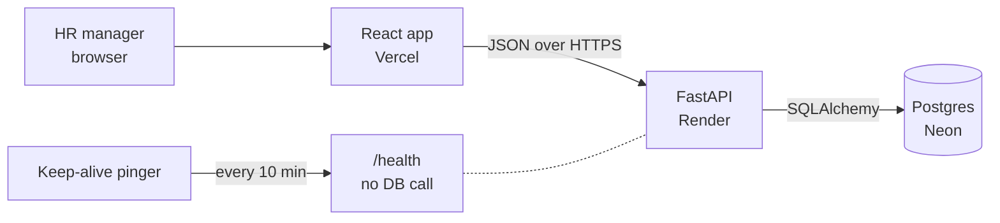
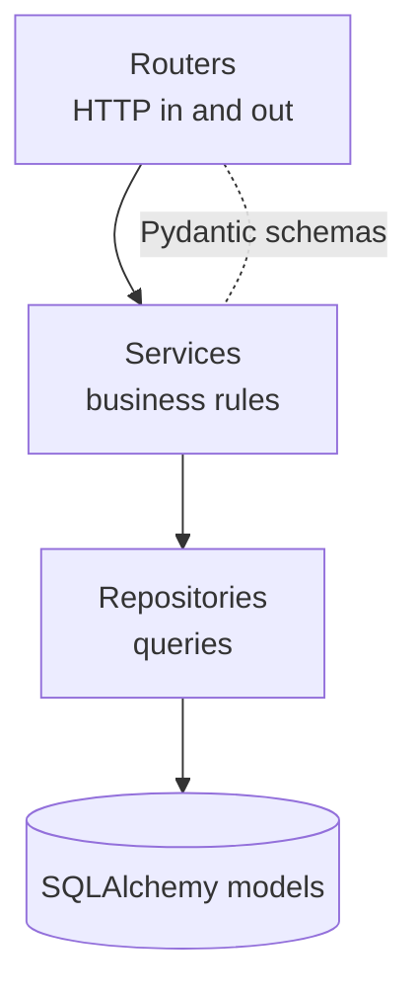
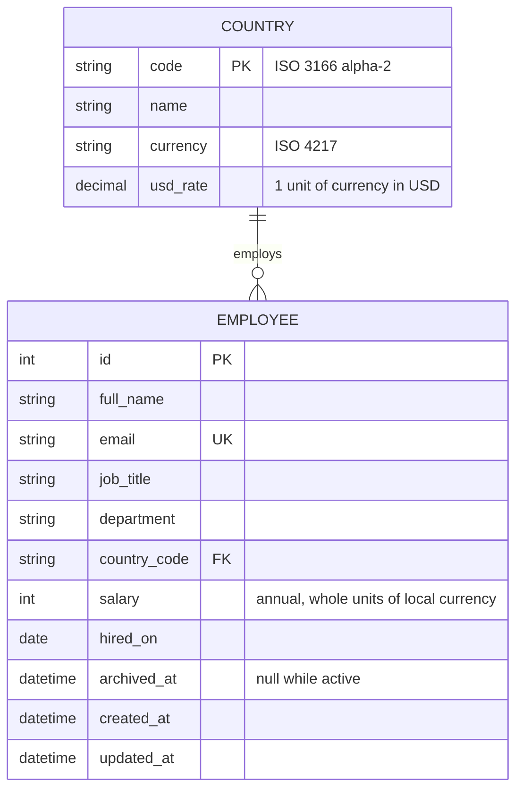

# Architecture

## System

One repo with two apps: `backend/` and `frontend/`. They share nothing except the API contract. Frontend types are generated from the backend's OpenAPI schema, so a change to an endpoint and its screen can land in one commit.

## Backend layers

- **Routers** parse requests and shape responses. No business rules.
- **Services** hold the rules: validation beyond types, salary changes, insights math, CSV parsing. Most unit tests live here.
- **Repositories** are the only code that writes SQL. Services can be tested with a fresh in-memory database.

## Data model

- **Indexes:** `country_code`, `job_title`, `department`, `archived_at`, and `(country_code, job_title)` for the per-title insight.
- **Countries** are seeded by a migration: US, GB, IN, DE, FR, CA, AU, JP, SG and BR. Adding one is a new migration row.
- **Departments** are a fixed list in code. A table is not worth it for one user and a short list.

## API

| Method | Path | Purpose |
|---|---|---|
| GET | `/api/employees` | Paged list with `q`, `country`, `job_title`, `department`, `sort`, `page`, `size` |
| POST | `/api/employees` | Create |
| GET | `/api/employees/{id}` | Read one |
| PATCH | `/api/employees/{id}` | Edit |
| POST | `/api/employees/{id}/archive` | Archive |
| POST | `/api/employees/{id}/restore` | Undo archive |
| GET | `/api/insights/countries` | Headcount and min, max, avg per country |
| GET | `/api/insights/countries/{code}/job-titles` | Headcount and avg per title in a country |
| GET | `/api/insights/distribution` | Salary buckets, optional `country` |
| GET | `/api/insights/summary` | Org-wide totals in USD |
| GET | `/api/reference` | Countries, departments and job titles for dropdowns |
| POST | `/api/employees/import` | CSV upload, returns a per-row report |
| GET | `/api/employees/export` | CSV of the current filters |
| POST | `/api/salary-adjustments/preview` | Bulk raise preview |
| POST | `/api/salary-adjustments` | Bulk raise apply |
| GET | `/health` | Liveness, never touches the DB |

## Trade-offs

| Decision | Chosen | Over | Why |
|---|---|---|---|
| Salary type | Integer, whole currency units | Decimal, minor units | Annual salaries are never quoted in cents. Integers are exact, fast to aggregate and behave the same in SQLite and Postgres. |
| Currency | Derived from country | Free field per employee | One less field to get wrong. Assumes everyone is paid in their country's currency. |
| Exchange rates | Fixed rates in the `country` table | Live FX API | Stable reports, repeatable tests, no network dependency. Rates convert only at report time, so stored salaries never change. |
| Test database | In-memory SQLite, plus a CI job on Postgres | Postgres everywhere | Unit tests stay in milliseconds. The Postgres job catches dialect gaps before deploy. |
| Prod database | Neon Postgres | SQLite on Render | Render's free disk is wiped on restart. Edits must persist. |
| Salary changes | One service method for every change | Direct field writes | If HR wants history, it is added in one place. Bulk raise and edit share the same path. |
| Delete | Archive with `archived_at` | Hard delete | Records are never lost. Insights skip archived rows. |
| Filtering UI | Own filter bar sending query params | DataGrid filter panel | The free DataGrid allows one filter at a time. Filters stay server-side and testable. |
| Auth | None | Login and roles | One trusted user is assumed. Pending HR's answer. |
| Cold starts | External pinger hitting `/health` every 10 minutes | Paid always-on plan | Free hosting without a 30 second wake-up. `/health` skips the DB so Neon can still sleep. |

## Performance

- **Never send 10,000 rows to the browser.** Lists are paged, sorted and filtered in SQL. Page size is capped at 100.
- **Insights are SQL aggregates.** `GROUP BY` on indexed columns. The browser receives a few dozen numbers, not rows.
- **Search** uses a case-insensitive `LIKE` on name and email. At 10,000 rows this is fast without full-text search.
- **Seeding** uses batched bulk inserts and a fixed random seed. 10,000 rows load in seconds and every run produces the same data.
- **Import** validates the whole file first, then writes valid rows in batches inside one transaction.
- Timings for list, insights and seed will be measured and recorded here once built.
