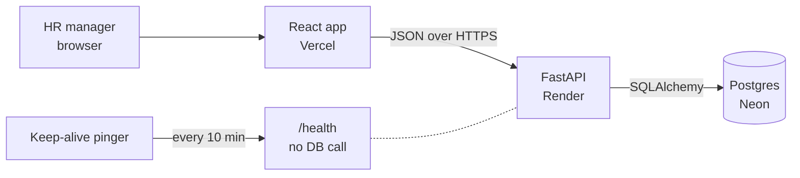
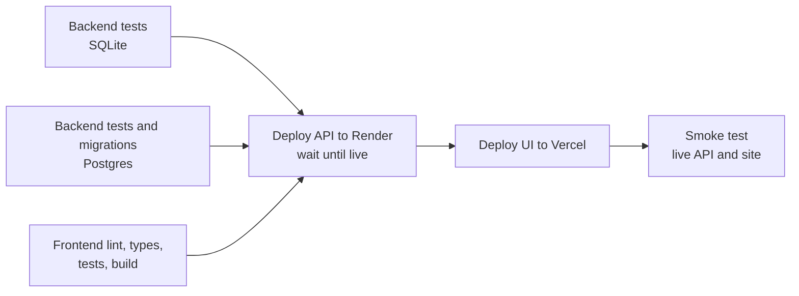
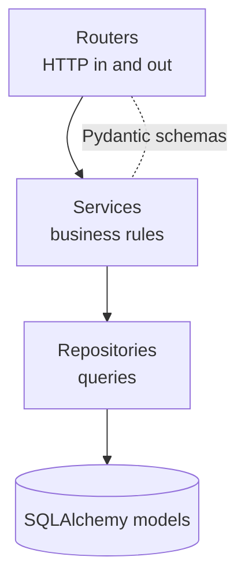
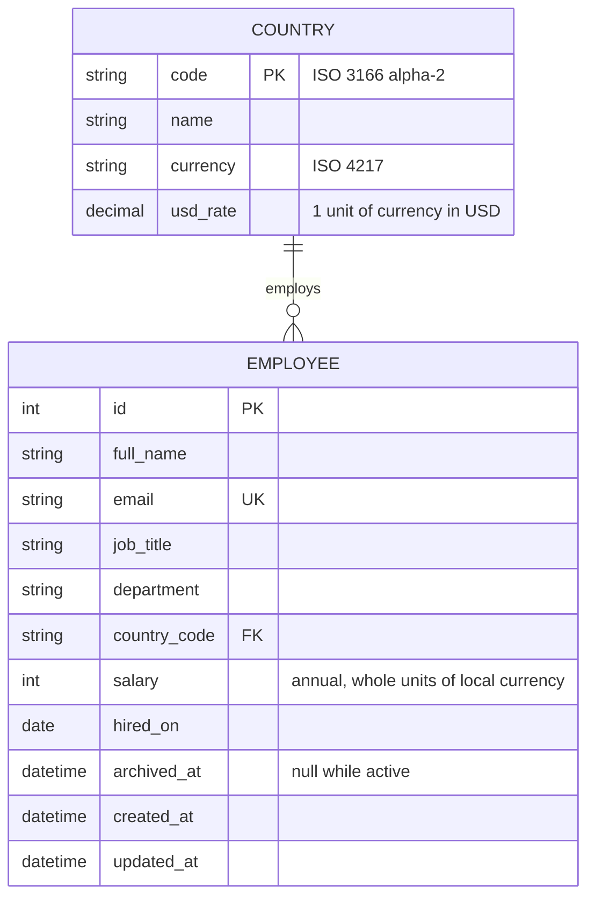

# Architecture

## System

One repo with two apps: `backend/` and `frontend/`. They share nothing except the API contract. The frontend's types in `src/api/types.ts` mirror the backend's Pydantic schemas, so a change to an endpoint and its screen lands in one commit.

## Delivery

| Branch | Role | CI | Deploys to |
|---|---|---|---|
| `develop` | Day-to-day work, default branch | Every push | Vercel preview |
| `production` | Live app, changed only by pull request from `develop` | Every push and PR | Render (API) and Vercel (UI) |

One GitHub Actions pipeline runs on every push and pull request:

- **Tests run on every branch.** The deploy jobs run only on `production`, and only when all three test jobs pass.
- **The pipeline is the only way to production.** Render auto-deploy is off, and Vercel skips Git deploys for `production`. `develop` still gets Vercel preview deploys.
- **The API deploys before the UI,** so a new screen never calls an endpoint that is not live yet.
- **Releases never overlap.** A concurrency group queues production runs and never cancels one halfway.

## Backend layers

- **Routers** parse requests and shape responses. No business rules.
- **Services** hold the rules: validation beyond types, salary changes, insights math, CSV parsing. Most unit tests live here.
- **Repositories** are the only code that writes SQL. Services can be tested with a fresh in-memory database.

## Data model

- **Indexes:** `country_code`, `job_title`, `department`, `archived_at`, and `(country_code, job_title)` for the per-title insight.
- **Countries** are seeded by a migration: US, GB, IN, DE, FR, CA, AU, JP, SG and BR. Adding one is a new migration row.
- **Departments** are a fixed list in code. A table is not worth it for one user and a short list.

## API

| Method | Path | Purpose |
|---|---|---|
| GET | `/api/employees` | Paged list with `q`, `country`, `job_title`, `department`, `status`, `sort`, `page`, `size` |
| POST | `/api/employees` | Create |
| GET | `/api/employees/{id}` | Read one |
| PATCH | `/api/employees/{id}` | Edit |
| POST | `/api/employees/{id}/archive` | Archive |
| POST | `/api/employees/{id}/restore` | Undo archive |
| GET | `/api/insights/countries` | Headcount and min, max, avg per country |
| GET | `/api/insights/countries/{code}/job-titles` | Headcount and avg per title in a country |
| GET | `/api/insights/distribution` | Salary buckets, optional `country` |
| GET | `/api/insights/summary` | Org-wide totals in USD |
| GET | `/api/reference` | Countries, departments and the job titles in use per department |
| POST | `/api/employees/import` | CSV upload, returns a per-row report |
| GET | `/api/employees/export` | CSV of the current filters and sort |
| GET | `/health` | Liveness, never touches the DB |

**CSV import rules.** Columns are matched by name, so their order does not matter and extra columns are ignored. A file missing a required column is refused whole. Otherwise every valid row is added and each bad row is reported with its line number and reason. Imported employees are active. An exported file can be imported again.

Planned for the "should have" features, not built yet:

| Method | Path | Purpose |
|---|---|---|
| POST | `/api/salary-adjustments/preview` | Bulk raise preview |
| POST | `/api/salary-adjustments` | Bulk raise apply |

## Trade-offs

| Decision | Chosen | Over | Why |
|---|---|---|---|
| Salary type | Integer, whole currency units | Decimal, minor units | Annual salaries are never quoted in cents. Integers are exact, fast to aggregate and behave the same in SQLite and Postgres. |
| Currency | Derived from country | Free field per employee | One less field to get wrong. Assumes everyone is paid in their country's currency. |
| Exchange rates | Fixed rates in the `country` table | Live FX API | Stable reports, repeatable tests, no network dependency. Rates convert only at report time, so stored salaries never change. |
| Test database | In-memory SQLite, plus a CI job on Postgres | Postgres everywhere | Unit tests stay in milliseconds. The Postgres job catches dialect gaps before deploy. |
| Prod database | Neon Postgres | SQLite on Render | Render's free disk is wiped on restart. Edits must persist. |
| Salary changes | One service method for every change | Direct field writes | If HR wants history, it is added in one place. Bulk raise and edit share the same path. |
| Delete | Archive with `archived_at` | Hard delete | Records are never lost. Insights skip archived rows. |
| Employee table | MUI table with server paging, sorting and own filter bar | MUI DataGrid | The free DataGrid allows one filter at a time and its virtual rows do not render in jsdom tests. A page is at most 100 rows, so a plain table is enough. |
| API types | Written by hand, mirroring the Pydantic schemas | Generated with `openapi-typescript` | The generator does not support TypeScript 6 yet. The API is small, and the frontend tests run against the same JSON shapes. |
| Migrations | Run by the start command before the server starts | Render pre-deploy step | Pre-deploy commands are a paid Render feature. Alembic skips work when the schema is current. |
| Distribution buckets | `CASE` sums in one query | `floor()` per row | Some SQLite builds lack math functions. `CASE` works the same on SQLite and Postgres. |
| Auth | None | Login and roles | One trusted user is assumed. Pending HR's answer. |
| Cold starts | External pinger hitting `/health` every 10 minutes | Paid always-on plan | Free hosting without a 30 second wake-up. `/health` skips the DB so Neon can still sleep. |

## Performance

- **Never send 10,000 rows to the browser.** Lists are paged, sorted and filtered in SQL. Page size is capped at 100.
- **Insights are SQL aggregates.** `GROUP BY` on indexed columns. The browser receives a few dozen numbers, not rows.
- **Search** uses a case-insensitive `LIKE` on name and email. At 10,000 rows this is fast without full-text search.
- **Seeding** uses batched bulk inserts and a fixed random seed. 10,000 rows load in seconds and every run produces the same data.
- **Import** checks every email in the file against the database in one query, not one per row. On a remote database each query costs a network round trip.
- **Seeding and import send rows in bulk.** Row-by-row inserts took over a minute against Neon. One multi-row INSERT per 1,000 rows takes about 4 seconds for 10,000.
- **The dashboard charts load as their own chunk,** so the employees page never downloads them. The main bundle is about 210 kB gzipped and the dashboard chunk about 95 kB.

### Measured on 10,000 seeded employees

SQLite on a laptop, average of five runs after one warm-up.

| Operation | Time |
|---|---|
| Seed 10,000 employees | 0.24 s |
| Pay by country | 10 ms |
| Pay by job title in one country | 2 ms |
| Org summary | 4 ms |
| Distribution, whole org in USD | 13 ms |
| Distribution, one country | 4 ms |
| List, first page | 4 ms |
| List, search plus sort by salary | 15 ms |
| List, page 400 | 20 ms |
| Export 10,000 employees to CSV | 0.2 s |
| Import 10,000 employees from CSV | 1.6 s |
| Seed 10,000 employees into Neon over the internet | 4.0 s |
